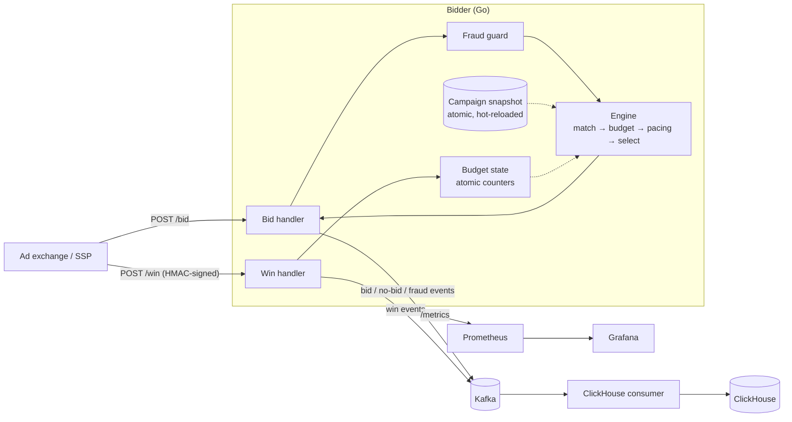

# RTB Bidder

A real-time bidding (RTB) engine for programmatic advertising, written in Go. It accepts OpenRTB-style bid requests from ad exchanges, decides in a few milliseconds whether and how much to bid, tracks campaign budgets, and streams every decision to Kafka and ClickHouse for analytics.


## What is RTB?

When a page or app has an ad slot, the exchange broadcasts a bid request to many bidders (DSPs) and waits roughly 100 ms for answers. Each bidder has to parse the request, pick a matching campaign, check that it can afford the bid, and reply, or decline. This project implements that bidder side, with a hard 20 ms deadline on the bid path.

## Architecture



## How a bid request is processed

1. **Parse.** The OpenRTB JSON is validated and mapped into internal domain types, so the engine never depends on the wire format.
2. **Fraud check.** Per-IP rate limiting, datacenter IP ranges, blocked domains and app bundles, and malformed request detection. Fraudulent requests get a `204` and are recorded with a reason.
3. **Match.** Each campaign creative is compared with the impression: format (banner, video, native), exact size, and the impression's bid floor.
4. **Budget check.** A candidate is dropped if bidding would exceed the campaign's daily or total cap.
5. **Pacing.** Spend is spread evenly across the day instead of being burned in the first minutes. A candidate is dropped if spend would run ahead of the expected curve, or if a single bid exceeds a configured fraction of the daily cap.
6. **Select.** The highest-priced remaining candidate wins.
7. **Respond.** The OpenRTB bid response is returned (`200`), or `204` for no-bid. Either way, an event is published to Kafka.
8. **Win notice.** When the exchange confirms a win, `/win` charges the campaign's budget and records the spend.

## Features

- **OpenRTB adapter layer** that isolates the wire protocol from the core domain.
- **Lock-free hot path.** Campaign data lives in an immutable snapshot swapped atomically every 30 s; budget counters are `sync/atomic` values in integer cents, so there are no mutexes in request handling.
- **Budget control** with daily and total caps and an automatic midnight reset.
- **Budget pacing** with a linear expected-spend curve and configurable tolerance.
- **Fraud guard** with per-IP QPS limiting, datacenter CIDR blocklist, domain and bundle blocklists.
- **Signed win notifications** using HMAC-SHA256 (`X-Signature`) with constant-time comparison.
- **Event pipeline**: every bid, no-bid, fraud and win event goes through Kafka into ClickHouse.
- **Observability**: Prometheus metrics for bids, no-bids, latency, fraud reasons, wins and spend per campaign.
- **Production-minded lifecycle**: `/healthz`, `/readyz`, request timeout middleware, and graceful shutdown that drains in-flight requests.
- **Small footprint**: static binary, distroless non-root container image.

## Tech stack

| Area | Choice |
| --- | --- |
| Language | Go 1.24+ |
| HTTP | `net/http` (standard library) |
| Messaging | Kafka via `segmentio/kafka-go` |
| Analytics storage | ClickHouse via `clickhouse-go` |
| Metrics | Prometheus client, Grafana dashboards |
| Packaging | Multi-stage Dockerfile, Docker Compose |

## API

| Method | Path | Description |
| --- | --- | --- |
| `POST` | `/bid` | Accepts an OpenRTB bid request. Returns `200` with a bid response or `204` for no-bid. |
| `POST` | `/win` | Win notification `{"campaign_id": 1, "price": 2.5}` signed with `X-Signature`. Returns `204`. |
| `GET` | `/healthz` | Liveness probe. |
| `GET` | `/readyz` | Readiness probe. Fails while draining or before campaigns are loaded. |
| `GET` | `/metrics` | Prometheus metrics. |

**Example bid request**

```bash
curl -i -X POST http://localhost:8080/bid \
  -H 'Content-Type: application/json' \
  -d '{
    "id": "req-1",
    "imp": [{ "id": "1", "banner": { "w": 300, "h": 250 }, "bidfloor": 0.0 }],
    "site": { "id": "s1", "domain": "example.com", "page": "https://example.com/article" },
    "device": { "ua": "Mozilla/5.0", "ip": "203.0.113.7", "devicetype": 2 },
    "user": { "id": "u1" }
  }'
```

**Example win notification**

```bash
BODY='{"campaign_id":1,"price":2.5}'
SIG=$(printf '%s' "$BODY" | openssl dgst -sha256 -hmac "$WIN_NOTIFY_SECRET" | awk '{print $NF}')

curl -i -X POST http://localhost:8080/win \
  -H "X-Signature: $SIG" \
  -d "$BODY"
```

## Getting started

### Prerequisites

- Go 1.24+
- Docker and Docker Compose

### Run with Docker Compose

```bash
cp .env.example .env          # adjust secrets
docker build -t rtb-bidder .
docker compose up -d
```

| Service | URL |
| --- | --- |
| Bidder | http://localhost:8080 |
| Prometheus | http://localhost:9090 |
| Grafana | http://localhost:3000 |

Create the ClickHouse table the consumer writes to:

```bash
docker compose exec clickhouse clickhouse-client --query "CREATE DATABASE IF NOT EXISTS dsp"
docker compose exec clickhouse clickhouse-client --query "
CREATE TABLE IF NOT EXISTS dsp.events (
    event_type    LowCardinality(String),
    request_id    String,
    impression_id String,
    campaign_id   UInt32,
    creative_id   UInt32,
    price         Float64,
    outcome       LowCardinality(String),
    exchange      LowCardinality(String),
    site_domain   String,
    app_bundle    String,
    device_type   LowCardinality(String),
    country       LowCardinality(String),
    timestamp     DateTime64(3)
) ENGINE = MergeTree
PARTITION BY toYYYYMM(timestamp)
ORDER BY (event_type, campaign_id, timestamp)"
```

### Run locally

Start the infrastructure (`kafka`, `zookeeper`, `clickhouse`, optionally `prometheus` and `grafana`) with Compose, then run the bidder on the host:

```bash
docker compose up -d zookeeper kafka clickhouse
export $(grep -v '^#' .env | xargs)
go run ./cmd/bidder
```

## Configuration

Configuration is read from environment variables (see `.env.example`).

| Variable | Description |
| --- | --- |
| `WIN_NOTIFY_SECRET` | Shared secret used to verify `/win` signatures. |
| `KAFKA_BROKERS` | Kafka broker address, e.g. `kafka:9092`. |
| `KAFKA_TOPIC` | Topic for bid and win events. |
| `CLICKHOUSE_DSN` | ClickHouse native address, e.g. `clickhouse:9000`. |
| `CLICKHOUSE_DB` | ClickHouse database (`dsp`). |
| `CLICKHOUSE_USER` | ClickHouse user. |
| `CLICKHOUSE_PASSWORD` | ClickHouse password. |

Bidding behavior is tuned in `cmd/bidder/main.go`: pacing tolerance and max bid fraction, bid timeout (20 ms), snapshot reload interval (30 s), and server timeouts.

## Observability

| Metric | Type | Labels |
| --- | --- | --- |
| `dsp_bidder_bids_total` | counter | |
| `dsp_bidder_no_bid_total` | counter | |
| `dsp_bidder_bid_latency_ms` | histogram | |
| `dsp_bidder_fraud_total` | counter | `reason` |
| `dsp_bidder_wins_total` | counter | `campaign_id` |
| `dsp_bidder_spend_total` | counter | `campaign_id` |

Go runtime and process collectors are exposed as well. Prometheus scrapes the bidder every 15 s using `internal/infra/prometheus/prometheus.yml`.

## Project structure

```
cmd/bidder/              Application entrypoint and wiring
internal/
├── adapter/
│   ├── http/            /bid, /win, /healthz, /readyz handlers, HMAC signing
│   └── openrtb/         OpenRTB wire types and mapping to the domain
├── domain/              Core types: campaign, creative, impression, budget, targeting
├── engine/
│   ├── pipeline/        Orchestrates match → budget → pacing → select
│   ├── matcher/         Creative / impression matching and bid floor
│   └── selection/       Winner selection
├── budget/              Atomic spend counters, caps, daily reset, win accounting
├── pacing/              Even spend delivery over the day
├── fraud/               Request-level fraud filtering
├── store/               Campaign loader, immutable snapshot, atomic hot reload
├── kafka/               Event types and producer
├── infra/
│   ├── clickhouse/      Kafka → ClickHouse consumer
│   └── prometheus/      Scrape configuration
├── middleware/          Request timeout and graceful-drain middleware
└── metrics/             Prometheus collectors
```

## Design notes

- **Domain isolation.** Handlers translate OpenRTB into domain objects, and the engine only sees domain types. Supporting another protocol version or exchange means adding an adapter, not touching the engine.
- **Snapshot instead of locks.** Reads see a consistent, immutable view of campaigns. Reloads build a new snapshot off the hot path and publish it with a single atomic store.
- **Integer money.** Spend is tracked in cents as `uint64` so counters can be updated atomically without floating-point drift.
- **Charge on win, not on bid.** Budget is consumed when the exchange confirms the win, so lost auctions cost nothing. Pacing and cap checks keep bidding from outrunning confirmed spend.
- **Fail fast.** A 20 ms deadline on the bid path returns a no-bid rather than a late response the exchange would discard anyway.
- **Analytics off the hot path.** Events are published asynchronously to Kafka and written to ClickHouse by a separate consumer group, so analytics never slow down bidding.

## Current scope and roadmap

This is a focused implementation of the bidder core. Intentionally simple for now:

- Campaigns come from an in-memory static loader (`internal/store/static_loader.go`) behind a `Loader` interface; a database-backed loader is the next step.
- Targeting bitmaps (geo, device, site, time) and dynamic CPM strategies are modelled in the domain but not applied by the matcher yet; only fixed `BaseCPM` pricing is used.
- Only the first impression of a request is evaluated.
- Budget state is per-instance and in memory, so running several replicas needs shared or periodically reconciled state.

Planned: persistent campaign store, targeting in the matcher, dynamic bidding with pCTR/pCVR multipliers, a load-test suite with published benchmarks, and unit tests for the engine, pacing and budget packages.